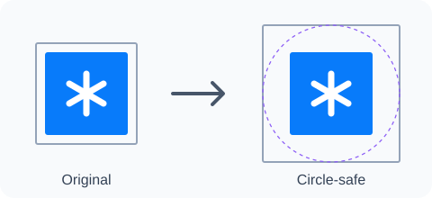

# circle-img

Prepare images for circular crops without cutting off meaningful content.
Useful for Google Contacts, avatars, and profile pictures. Output is a square
PNG with enough space for a centered, inscribed circular crop.



## Install and run

Requires Python 3.11+ and Pillow 13. From this folder:

```bash
python3 -m venv .venv
.venv/bin/python -m pip install -r requirements.txt
./circle-img.py -i logo.png
```

```bash
./circle-img.py -i logo.png -o avatar.png --margin 12 --preview
./circle-img.py -i logo.png -o exports/  # existing folder: exports/logo.png
./circle-img.py -i ~/Desktop/*.png -o ~/Desktop/circle -O  # folder must exist
./circle-img.py -i first.png second.png --margin 12
./circle-img.py -i logo.png --background '#f5f5f5'
./circle-img.py -i logo.png --background transparent
./circle-img.py -i logo.png --min-size 512  # use 0 for the tightest fit
./circle-img.py -i logo.jpg --source-background white --tolerance 10
./circle-img.py -i photo.png --mask foreground-mask.png
./circle-img.py -i colored-circle.png --background-layers 2
```

Run `./circle-img.py` directly; no environment activation is needed. If the
current Python lacks Pillow, the script automatically uses `.venv/bin/python`
beside the script, even when invoked from another directory or through a symlink.
The setup above is only needed once; nothing is installed automatically.

## Options

| Option | Behavior |
| --- | --- |
| `-i`, `--input FILE [FILE ...]` | One or more raster images; required. Accepts shell-expanded wildcards and repeated `-i`. |
| `-o`, `--output FILE\|DIR` | PNG file or existing directory. A directory keeps the input filename for PNG inputs; other extensions become `.png`. Default: `<input-stem>-circle.png` beside each input. Multiple inputs require an existing directory when `-o` is supplied. Parent must exist. |
| `-b`, `--background COLOR` | When omitted: reuse the innermost excluded background color; transparency becomes white. With a mask, defaults to white. Override with a Pillow color name, hex color, or `transparent`. |
| `--background-layers 1\|2` | Number of backgrounds to exclude, outside inward; default **1**. Use **2** for a colored circle/tile inside transparency or corner background. Cannot combine 2 with an explicit source background or mask. |
| `--min-size N` | Nonnegative minimum output side length in pixels; default **256**. Use `0` to disable the floor. Adds background padding without resizing artwork. |
| `--margin N` | Nonnegative integer minimum clearance from content to the **circle**, in output pixels; default 0. |
| `--source-background COLOR` | Explicit opaque source background color; overrides automatic detection. |
| `--tolerance N` | Maximum difference in any RGB channel from source background, 0–255; default 8 for automatic detection, otherwise 0. Applies to explicit or inferred source color. Only 0 is allowed with a mask. |
| `--mask FILE` | Single-frame grayscale mask matching oriented input dimensions: white retains, black removes, gray reduces original alpha proportionally. The same mask is applied to every input. Exclusive with source background. |
| `--preview` | Also save `<output-stem>-preview.png`, a circular-crop preview with transparent corners. |
| `-O`, `--overwrite` | Replace existing output/preview files; input and mask are always protected. |
| `-v`, `--verbose` | Timestamped settings, batch position, detection details, colors, geometry, and stage timings on stderr. |
| `-h`, `--help` | Show CLI help. |

## Multiple images

The shell expands unquoted wildcards before running the script:

```bash
mkdir -p ~/Desktop/circle
./circle-img.py -i ~/Desktop/*.png -o ~/Desktop/circle -O
```

Quote individual filenames containing spaces, but do not quote the wildcard.
The script does not expand literal wildcard patterns. You can also list files
explicitly or repeat `-i`. Inputs are processed in the supplied order.

With multiple inputs, `-o` must be an existing directory or omitted. Without
`-o`, each result is saved beside its input with the `-circle.png` suffix.
All processing options apply to every input; a supplied mask must match each
image's oriented dimensions. Errors identify the affected file, processing
continues with the remaining files, and the command exits with status 1 if any
image failed (0 when all succeed). Invalid command syntax exits with status 2;
interruption exits with status 130. Successful outputs are retained.

Before processing starts, conflicting destination paths abort the whole batch,
even with `-O`. This includes two inputs mapping to the same PNG name, duplicate
inputs, preview/output collisions, and names differing only by case. No output
may replace any input or the mask. Keep output files in a separate directory
when using wildcards so later runs do not include previous results as inputs.

## Timestamps, progress, and verbose output

Every run prints the local date `[YYYY-MM-DD]` before its first operational
message. Messages use local `[HH:MM:SS]` timestamps, including `processing:`
before each file, saved-file messages, and errors. Only the first line of a
multiline message is timestamped. Help, usage, and blank lines are undecorated.
If the run ends on a different date, that date is printed after the last message.

In an interactive terminal, stderr shows the current stage and a spinner
immediately. After **5 seconds**, it also shows a live elapsed counter, counted
from the stage's start (not from when the counter appears). Its timestamp stays
fixed at the **stage's start time**:

```text
[14:07:03] Removing background layer 2... elapsed 8s /
```

When the stage finishes, that line is replaced by a permanent completion line
with the **finish timestamp**. The duration is included only when the stage took
**at least 10 seconds**, in both normal and verbose modes:

```text
[14:07:17] Removed background layer 2 (took 14.2s)
```

Elapsed durations use a monotonic clock, so changing the system clock does not
change the measured processing time. There is no estimated percentage. Stage
labels shorten to fit the stderr terminal while keeping the clocks visible. Live
redraws are suppressed if the terminal is too narrow to show both clocks.

Redirected stderr and terminals with `TERM=dumb` receive no animation or terminal
control codes. Normal redirected output contains processing and saved-file
messages, plus errors if needed. Saved-file messages include elapsed time since
that file's processing began; a preview's elapsed time includes the main output.
Each successful save reports elapsed time, even for quick operations. Failed
saves have no completion total; earlier successful saves remain reported.
The live counter starts at 5 seconds; completion
durations start at 10 seconds. These shared thresholds are defined once in
`Reporter.ELAPSED_DELAY` and `Reporter.DURATION_THRESHOLD`, so every processing
stage uses the same behavior without extra command-line options.

Use `-v` / `--verbose` for permanent diagnostics as processing happens:

```bash
./circle-img.py -i colored-circle.png --background-layers 2 -v
./circle-img.py -i colored-circle.png --background-layers 2 -v 2>details.log
```

Verbose stderr reports resolved settings, file position in a batch, stage starts
and completion times, each background layer's detection method and color, the
selected output color, remaining content dimensions, final dimensions, placement,
margin, and minimum size. Normal processing and saved-file messages stay on stdout.
The initial date is written to whichever stream receives the first message.
Reporting does not change output pixels. Errors identify the affected file when
processing has begun. In an interactive terminal or verbose mode, failures also
clear any live line and report the failed stage. Preflight failures have no stage
to report; interrupted runs exit with status 130. A preview failure can
leave an already saved main output, which is reported separately.

This follows the same date/time and verbose-stream convention as pdf-slim.
Keep timestamp formatting, stream separation, and documented terminal behavior
consistent when changing reporting; preserve tests for same-day completion,
midnight rollover, live updates, and redirected output.

## Background layers

Usually no background options are needed. The script excludes **one background**
from fitting, then uses its color for the output. **Transparency becomes white**
by default. Use `--background transparent` to keep transparency, or choose any
explicit output color.

When the image contains two backgrounds, use `--background-layers 2`:

```bash
./circle-img.py -i colored-circle.png --background-layers 2
```

Layers are counted **outside inward**; they are not file-format layers:

| Input | Default: one layer | Two layers |
| --- | --- | --- |
| Artwork on a flat opaque color | Fit artwork; reuse that color | Attempt another background; reject if none can be identified confidently |
| Colored circle on transparency | Fit the entire circle; white output background | Exclude transparency and circle color; fit inner artwork and reuse circle color |
| Colored tile with white rounded corners | Exclude white corner remnants; fit the colored tile on white | Exclude corners and tile color; fit inner artwork and reuse tile color |

Choose `--background-layers` for **what to fit**, and `--background` for
**what color to put behind it**. `--source-background` is only a manual override
when detection needs an explicit source color.

Output color is independent of the layer count: `--background white`, another
color, or `transparent` overrides the detected output color. Each image in a
batch gets its own detected color. The 256-pixel minimum still applies; use
`--min-size 0` for the tightest fit without enlarging the artwork.

### Detection and limitations

For the first layer, any existing transparency defines foreground coverage:
every nonzero alpha counts, including faint edges and shadows. For fully opaque
images, at least 95% of the rectangular border must agree on one color. Matching
pixels are removed by four-connected flood fill; enclosed same-colored details
remain intact.

If the rectangular border disagrees, detection checks for a flat rounded tile
with four matching corner remnants. At least 95% of the middle half of each edge
must agree on the tile color. Corner patches must have similar colors and sizes,
narrow inward, and fit within a quarter of the shorter image dimension. Their
colors must be consistent with a blend into the tile color. Only the corners are
excluded for one-layer fitting; the colored tile remains meaningful content.

For layer two, the script samples inward from the visible shape's boundary,
requiring 95% color agreement separately on all four sides. It removes connected
background pixels and a narrow outer fringe, preserving enclosed details. The
fringe band is 2–16 pixels, scaled to the visible shape's size; it allows partial
alpha and up to 32 levels of RGB variation (or the specified tolerance if larger).
Contrasting opaque content touching this boundary is rejected. The visible shape
must be at least 12 pixels on each axis and provide enough opaque samples.

Automatic detection uses a default per-channel RGB tolerance of 8 for small
compression variations; `--tolerance` overrides it. It does not reconstruct
foreground edges already blended into an opaque background. A different output
color can reveal residual halos. Retained pixels are not resampled.

This is a heuristic for simple flat backgrounds, not semantic segmentation.
Artwork can resemble another background, particularly a solid border or frame.
Matching marks in all four corners can resemble corner remnants. Two-layer mode
intentionally treats the outer fringe as background, including faint marks there;
use one layer or a mask when those marks are meaningful. Photos, gradients,
uncertain boundaries, and missing second backgrounds may be rejected. Empty
foreground is an error. The script does not silently fall back to one layer.

### Advanced overrides

- `--source-background COLOR` explicitly selects one opaque source color to
  remove from the rectangular border, overriding alpha-based detection. With
  automatic output color, that selected color is reused. Its default tolerance
  is 0; supply `--tolerance` for approximate matching.
- `--mask FILE` defines coverage, multiplied by original alpha. White retains,
  black removes, gray reduces alpha. Automatic output color is white because a
  mask does not identify a background color. Explicit output colors still work.

Source background and mask are mutually exclusive, and neither can be combined
with `--background-layers 2`. A mask cannot be combined with a nonzero tolerance.
Explicit colors are interpreted in the input's RGB color space. Enclosed areas
are preserved by color-based removal; use a mask to remove those too.

## Geometry and quality

The script applies EXIF orientation and finds the smallest enclosing circle of
the foreground's **pixel corners**. It centers that circle on a square canvas,
allowing asymmetric artwork to shift away from bounding-box centering for a
tighter fit. This is geometric fitting, not centering by visual mass.

All foreground pixel areas must fit within the circle with the requested margin.
The artwork itself is never resized. Placement uses whole pixels: the script
checks the four placements surrounding the ideal position and enlarges the
canvas if needed. This rounding can add up to two pixels to the ideal canvas
side; it does not search every possible whole-pixel placement.

The canvas side is at least `--min-size` (default **256 pixels**) and large enough
for the foreground plus radial margin. The original image dimensions do not set
a lower bound: excess background on large inputs can be discarded. Small artwork
receives additional background padding, not enlargement; large artwork is never
shrunk to meet the minimum. Use `--min-size 0` for a tight fit without a size floor,
or another nonnegative integer to choose a different floor. Whole-pixel placement
can require an extra pixel even when the requested minimum would otherwise fit.

For a fixed center, required side length is at least `ceil(2 × (radius + margin))`;
integer placement may require extra pixels. A filled square needs more
padding than a circular silhouette. Margin zero provides geometric containment;
use a positive margin for extra visual space or crop-rendering differences.

Output uses lossless PNG. Transparent output preserves foreground RGBA values;
colored output deliberately alpha-composites edge pixels over the new color.
ICC profiles, PNG sRGB/gamma markers, and resolution metadata are retained when
present. EXIF is not copied after orientation. Standard 8-bit RGB, RGBA,
grayscale, and palette images are supported. Multi-frame images, 16-bit PNG, and
unsupported modes such as CMYK are rejected rather than silently converted with
precision or color loss. JPEG decoding cannot recover detail already lost in the
source. This is not a universal high-bit-depth archival conversion tool.

Only the optional preview applies an antialiased circular mask. Upload the square
output and use the full centered crop. The script cannot control a service's
resizing, compression, transparency handling, or a manually repositioned crop.

Writes use a temporary file beside each destination and atomic publication.
With `-o exports/`, an existing directory receives `logo.png` for input `logo.png`,
or `photo.png` for input `photo.jpg`. PNG filename capitalization is preserved.
The optional preview is saved beside the result as `<output-stem>-preview.png`.
Directories are not created automatically; a destination that is not an existing
directory is treated as an explicit PNG filename. Selecting the input's own
directory for a PNG input is rejected because it would replace the source,
even with `-O`.

Existing files require `-O` or `--overwrite`; inputs and masks cannot be destinations,
even through symlinks or hard links. Output and preview are separate writes; if
preview writing fails after output succeeds, the output remains available.

## Development and verification

Run the complete suite:

```bash
.venv/bin/python -m unittest discover -s tests -v
```

GitHub Actions runs this suite on pushes to `main` and pull requests, using
Python 3.11 and 3.15 on Linux and Python 3.15 on macOS. Each job creates the
documented `.venv` and also checks direct CLI execution with the sample image.
The [Tests workflow](.github/workflows/tests.yml) can also be started manually.

Tests use generated, explicitly checked fixtures and independently check every
foreground pixel corner against the output circle. Coverage includes alpha and
pixel preservation, circle geometry, margins, flood-fill boundaries, masks,
metadata, file protection, CLI errors, and preview behavior.

`tests/test_preservation.py` adds asymmetric multicolor artwork, mixed alpha,
holes and disconnected marks, independently known tight canvas sizes, and
end-to-end checks of saved PNG pixels, radial clearance, custom backgrounds,
and ICC profiles. Reusable inputs and explicit boundary cases live in
`tests/fixture_data.py`. These checks allow artwork placement to change while
requiring its pixels to remain intact. Background-confidence cases cover below,
at, and above the documented 95% threshold.

`tests/test_optimized_geometry.py` checks a synthetic shield in four orientations,
saved output, independently known enclosing circles, and fixture reproducibility.
It also compares 500 repeatable point sets against an exhaustive test-only solver
that checks every possible one-, two-, or three-point support circle using exact
rational arithmetic. Known geometric solutions independently validate that solver.
These checks run with the complete suite, including in GitHub Actions.
The shield's broad shoulders and tapered base exercise tighter fitting without
using company artwork. Rebuild it with:

```bash
.venv/bin/python tests/fixtures/generate_shield.py
```

`tests/test_circular_foreground.py` covers circular foreground content: tight
fitting, radial margins, off-center input on a larger canvas, faint edge pixels,
and saved PNG preservation. Its multicolor disk fixture has an independently
verified 60-pixel enclosing radius. Rebuild it with:

```bash
.venv/bin/python tests/fixtures/generate_disk.py
```

`tests/test_edge_background.py` validates edge inference and the foreground mask
against a synthetic rounded tile, including blended corners, small color variations,
transparent corners, enclosed artwork, ambiguous inputs, margins, and batch output
colors. Rebuild the fixture with:

```bash
.venv/bin/python tests/fixtures/generate_rounded_tile.py
```

`tests/test_background_layers.py` independently validates a synthetic circle with
an alpha/compression fringe, enclosed colors, and a disconnected alpha-1 mark.
It covers outside-in layer selection, rounded corners, output color defaults and
overrides, ambiguous or missing second backgrounds, margins, saved pixels, batch
colors, minimum size, and advanced-option conflicts. Rebuild its fixture with:

```bash
.venv/bin/python tests/fixtures/generate_layered_circle.py
```

`tests/test_background_optimization.py` checks optimized background masks against
independent pixel-by-pixel references. Coverage includes four-neighbor connectivity,
enclosed islands, diagonal contact, narrow paths, image borders, exact square
erosion, color-tolerance boundaries, partial alpha, and contrasting fringe
rejection. Hundreds of repeatable generated masks exercise the same rules without
using machine-dependent speed limits in CI.

The second-layer detector computes color masks in Pillow and flood-fills whole
row segments. Square erosion uses overlapping shifted masks to reduce filter
passes. These optimizations preserve the detection thresholds and pixel values;
they do not resize the image or require additional dependencies. When changing
this path, compare both foreground masks and saved output with the previous
implementation, and measure full-command timing separately from profiler timings.

`tests/test_min_size.py` checks the 256-pixel default, custom and disabled floors,
large padded inputs, artwork or margins exceeding the floor, exact pixel
preservation, saved output and preview dimensions, and invalid values.
Geometry tests use explicit small or zero minima where necessary to exercise
tight fitting independently of the default output floor.

`tests/test_reporting.py` uses independently verified clock and terminal helpers
to check fixed start timestamps, completion timestamps, midnight rollover,
monotonic elapsed time, the 5- and 10-second thresholds, live counter updates,
thread cleanup, and redirected output. Real subprocess checks cover a
pseudo-terminal, both verbose spellings, errors, batch continuation, preview
failures, and identical saved pixels with
reporting enabled or disabled. These checks run in the normal suite and CI.

Regression checks should be shown to fail under a narrow temporary fault before
being accepted; restore the implementation and rerun the complete suite afterward.

For visual verification with the AI-generated blue ribbon fixture under
`tests/fixtures/` (also used by the CI direct-execution check):

```bash
./circle-img.py \
  -i tests/fixtures/blue-ribbons.png --margin 12 --preview -v
```

Inspect both the square output and circular preview. Generated circle images
and the local virtual environment are ignored by `.gitignore`.
